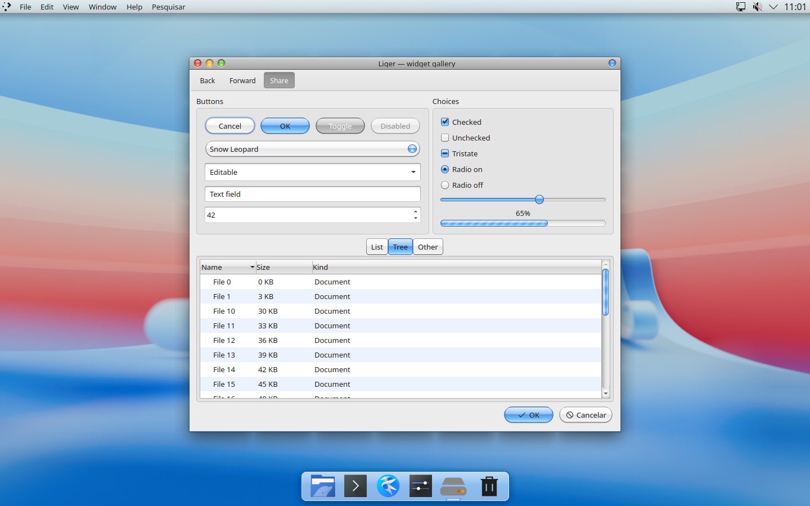
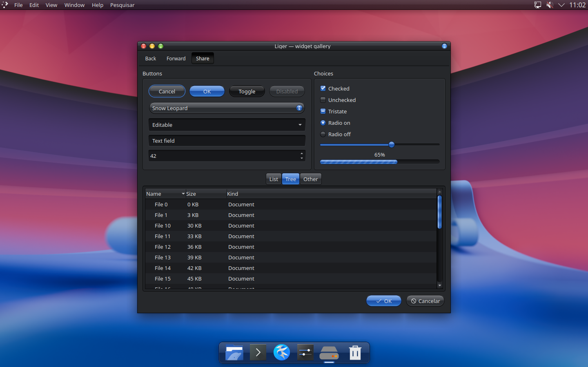
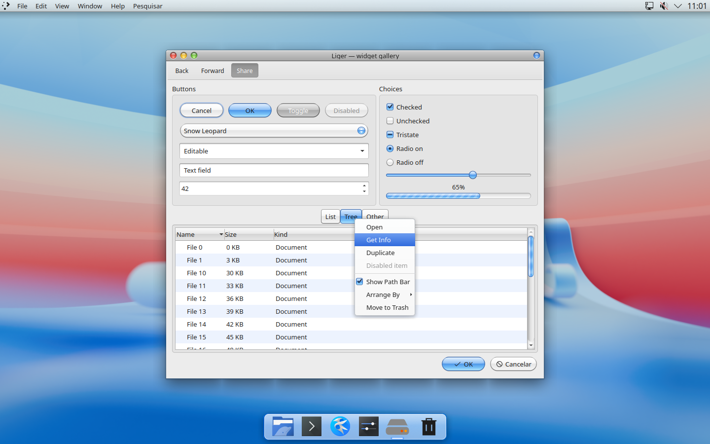
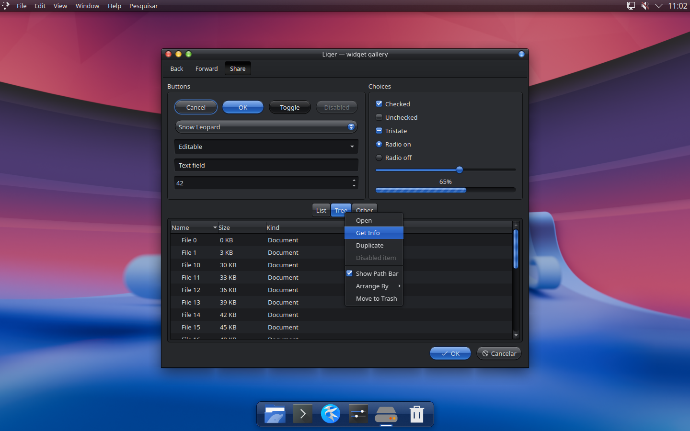
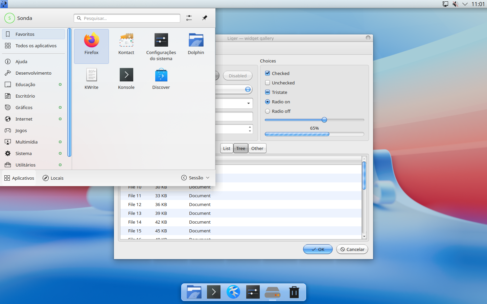
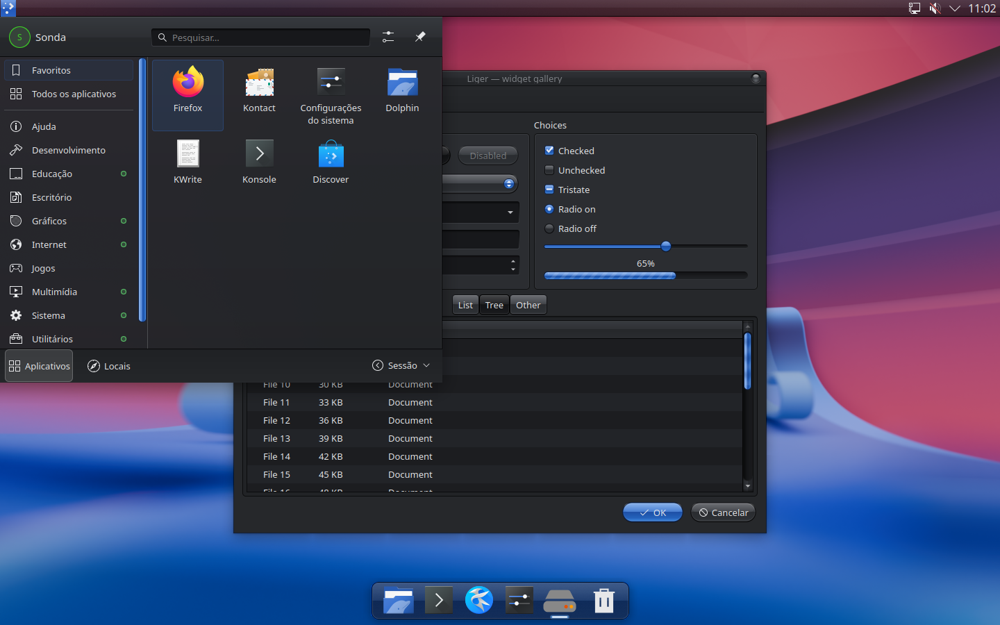

# Liger

Aqua for KDE Plasma 6, after Mac OS X Snow Leopard → Mavericks, in the
"lickable" spirit: gel buttons, candy progress bars, traffic lights.

**DarkLiger** is the dark variant Aqua never had: the same proportions, gems and Aqua-blue
accent, but the brushed metal and greys become QuickTime X smoked glass. Gradients break
hard at a reflection line instead of melting (think OS X by way of Windows Vista), and it
follows current dark-theme conventions: light text on dark surfaces, no large bright areas.
Translucent panels and popups use KWin blur; opaque fallbacks are included.

| Liger | DarkLiger |
|---|---|
|  |  |
|  |  |
|  |  |

Parts (all generated by Python from `generator/`, nothing hand-drawn). Each exists
twice, as `Liger` and `DarkLiger`:

| Part | Where it goes |
|---|---|
| Plasma Style `Liger` / `DarkLiger` (menu bar, 2D dock, popups, tooltips, widgets) | `~/.local/share/plasma/desktoptheme/` |
| Window decoration (Aurorae) `Liger` / `DarkLiger` | `~/.local/share/aurorae/themes/` |
| Colour scheme `Liger` / `DarkLiger` | `~/.local/share/color-schemes/` |
| Kvantum theme `Liger` / `DarkLiger` (application widgets) | `~/.config/Kvantum/` |
| Global theme `org.kde.liger.desktop` / `org.kde.darkliger.desktop` (ties it together + menu bar/dock layout) | `~/.local/share/plasma/look-and-feel/` |

## Install

```sh
./install.sh                # build and copy both themes, nothing applied
./install.sh --apply        # also apply the Liger global theme (keeps your panels)
./install.sh --layout       # apply AND replace panels with menu bar + dock
./install.sh --dark --apply # same, with DarkLiger (also works with --layout)
./install.sh --remove       # uninstall both
```

You can also switch between them at any time in System Settings → Global Theme.

Requires Python 3 with Pillow and NumPy to build; Kvantum for the application style.

## Develop

`python3 build.py` regenerates `build/` (both variants; `--variant light|dark` builds one).
`tools/testsession.sh` renders everything in an isolated headless Plasma session and writes
screenshots to `previews/` (`THEME=DarkLiger tools/testsession.sh <dir>` for the dark one).
See **PROGRESS.md** for architecture, status and next steps.

## GTK applications

For GTK apps (GNOME, Firefox, LibreOffice with the GTK backend…), use the matching
[OS X Mavericks GTK theme](https://github.com/B00merang-Project/OS-X-Mavericks) by the
B00merang Project, which Liger used as its reference. Install it into `~/.themes` and
select it in System Settings → Colours & Themes → Application Style → Configure GNOME/GTK
Application Style. With DarkLiger, a dark GTK theme (e.g. Adwaita-dark) blends in better.

## Notes

* After `./install.sh`, running sessions are refreshed automatically (KWin reconfigure,
  Plasma theme cache cleared). Restart applications to see Kvantum changes.
* Kvantum limitations: vertical (row) table headers reuse the horizontal header art
  rotated, and scrollbar arrows are always one per end.
* The window title cannot be engraved: Plasma 6's Aurorae has no text-shadow support.

## License

GPL-3.0-or-later (see `LICENSE`). Everything is drawn procedurally; no Apple artwork
is included. Mac OS X and Aqua are trademarks of Apple Inc.; this project is not
affiliated with Apple.
